# AI Workbench

*Your models. Your rules.*

A browser-based AI workbench: agent chat (Hermes / OpenCode / any OpenAI-compatible model), project files with Monaco and managed live app previews, a markdown wiki with `[[wikilinks]]`, an Excalidraw spatial board, HTML artifacts, diagrams, spreadsheets and slide decks, a job board where Hermes plans work and isolated OpenCode workers execute it, and host resource monitoring.

Chat is the central workspace. On desktop, open **Documents** or **Projects** from the left navigation to work in a focused **Canvas** beside chat. Use **New** in the Canvas header to create an item, and **Related work** to open items or files linked to the conversation. Under **Project**, use the file dropdown to navigate folders and open a workspace file, or filter Canvas items by folder. Other tools, including **Source Control**, remain available separately from the tool rail. Resize or expand the panel, and close or reopen Canvas without losing the conversation or editor state. Phones use a **chat-only** layout without the canvas, tool rail, or monitoring. Normal desktop page loads start with chat only; `?tab=...` links still open a specific workspace on desktop.

**Documents** is the first content workspace in Canvas. Create a Markdown document as a chat draft or link it to an existing workspace project folder, edit and preview it, then use **Save** and **Download**. Find it again under its chat or filter Canvas items by project folder in **Related work**. Documents are stored in the managed server library (`$HERMES_HOME/spatial-workbench/documents.json`), not as project files; include that library in backups. A stale save is rejected rather than overwriting another edit.

Chat includes the visible Canvas context with each message, including up to 12,000 characters of an open Canvas item, project file, or wiki note; this is sent to the selected model provider. A tool-enabled direct API assistant can read and edit Canvas items, and the bundled Workbench MCP server provides the same tools to a configured Hermes Gateway after the updated server is deployed and reloaded. Other providers may not have those tools. AI edits retain a restorable previous version under **History**; unsaved editor changes are preserved if an item changes elsewhere. Other workspaces currently provide their name, not detailed selection context.

Project files opened in Canvas are linked to the active chat by path and appear alongside its documents; removing a link does not delete the file. The project file remains the source of truth. Use **Browse files** to choose another file and **History** to restore snapshots made by Workbench file writes, including its AI file tools. Earlier backups and changes made directly by external tools are not listed in this history. A changed file refreshes in a clean editor; a dirty editor retains its buffer and offers a comparison. Workbench AI writes check the file version rather than forcing an overwrite. Gateway tools need the updated MCP server, and other agent tools may write outside the Workbench's recovery mechanism.

In **Projects**, import or open an image and choose **Edit image** to draw on it or crop it using pixel coordinates. **Save PNG copy** writes a new file beside the original without overwriting it. The editor supports images up to 16 megapixels; PNG copies flatten animation and layers and must fit the 10 MB upload limit. To generate or edit an image with AI, ask Hermes in chat; it must have an appropriate image tool or ComfyUI skill configured and access to the workspace. Its output may need to be opened manually in Projects. Provider availability and Gateway image generation have not been verified by the Workbench.

Create an interactive visualization with **New → Interactive HTML**, or ask a tool-enabled assistant to create one. Choose a chat draft or project for the first item; later items can reuse that location, or use **Choose type and location** to pick another. HTML items live in the managed document library, not the project filesystem. The preview opens by default; switch between **Source**, **Split**, and **Preview** without discarding changes. Save, download, AI editing, and version history work as with documents. Direct API and Gateway creations open automatically unless another editor has unsaved changes, in which case chat offers **Open in Canvas**. Gateway creations are checked approximately every three seconds while the chat is open.

HTML runs scripts and forms in a sandboxed frame without same-origin access to the Workbench, but it can make network requests. Only preview HTML you trust with network access. Gateway creation requires the updated Workbench MCP server and companion API to be deployed and connected to the same document library.

Use **New → Visual diagram** for a draggable Excalidraw drawing, or **New → Mermaid diagram** for editable Mermaid source and a rendered preview. Both are separate, chat-linked Canvas items in the managed document library; they do not modify the shared Spatial Board. Save changes explicitly, reopen items from **Related work**, and download visual diagrams as `.excalidraw` or Mermaid source as `.mmd`. The formats are separate and do not automatically convert between each other. A tool-enabled direct API assistant can create and edit them using Canvas tools; Gateway support needs the updated Workbench MCP server and has not been verified.

Use **New → Spreadsheet** or **New → Slide deck** to create editable Canvas items, or import an `.xlsx` workbook or `.pptx` presentation. Click text on a slide to edit it; use its handles to move or resize the text box, or focus a handle and use arrow keys (Shift for larger steps). Export creates `.xlsx` and `.pptx` files. Spreadsheet formulas are retained with cached results but are not calculated in Canvas; exported workbooks request recalculation when opened in Excel. Imports are limited to 10 MB compressed and 20 MB expanded. XLSX import preserves basic values and formulas, not formatting, charts, macros, or other advanced workbook features. PPTX import preserves editable text and approximate positions; images, charts, themes/layout fidelity, transitions, and animations are not preserved.

Browser tabs and bookmarks use the violet chat-and-canvas icon. On iPhone, use Safari's **Share → Add to Home Screen** for the matching home-screen icon. Icon assets ship in `spatial-workbench/public/` and are copied into production builds.

## Screenshots

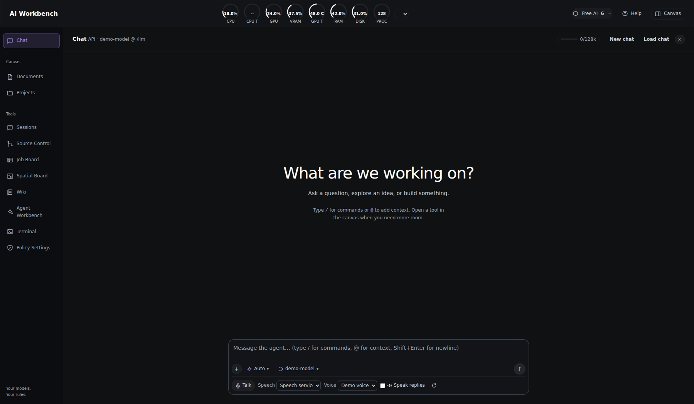

These screenshots use demo content, simulated conversation and metrics. Jobs and model listings are fictional.

### Canvas

| Document | Interactive HTML | Diagram |
|---|---|---|
| [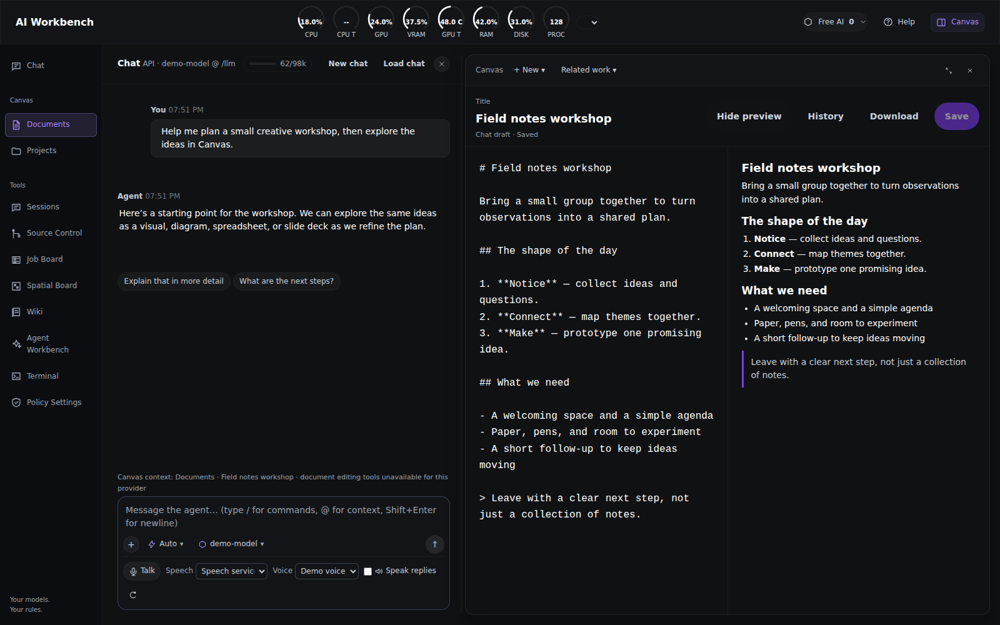](screenshots/canvas-document.png) | [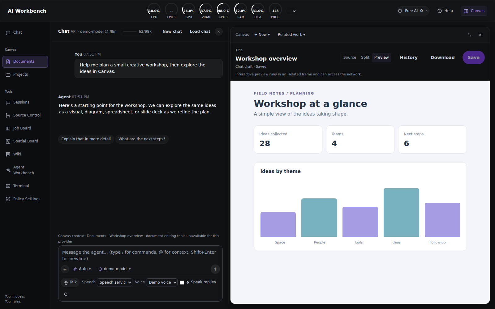](screenshots/canvas-interactive-html.png) | [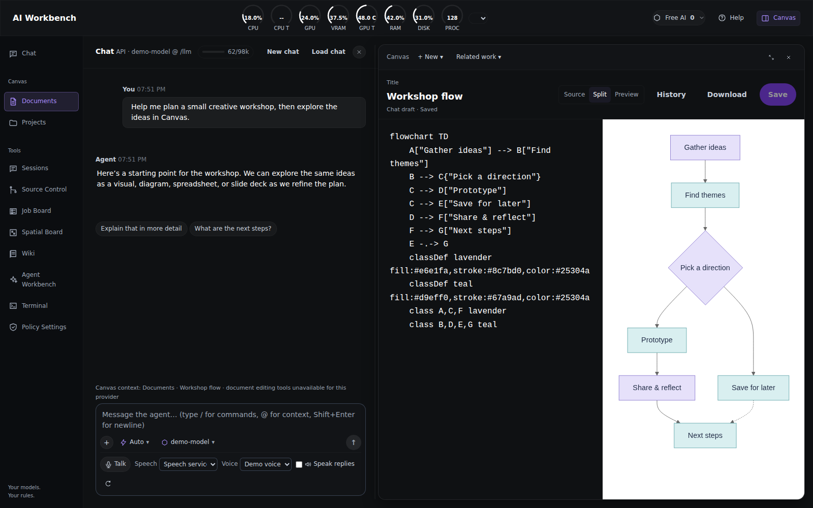](screenshots/canvas-diagram.png) |
| **Spreadsheet** | **Slide deck** | **Image editor** |
| [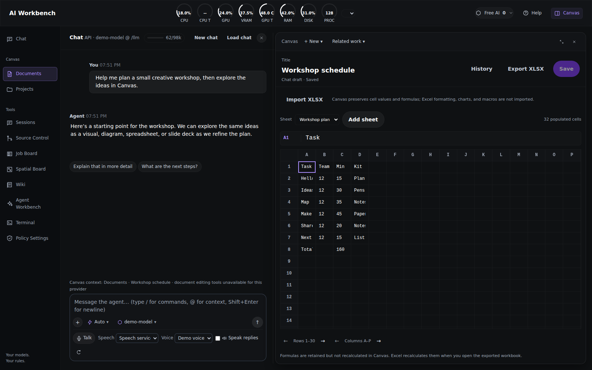](screenshots/canvas-spreadsheet.png) | [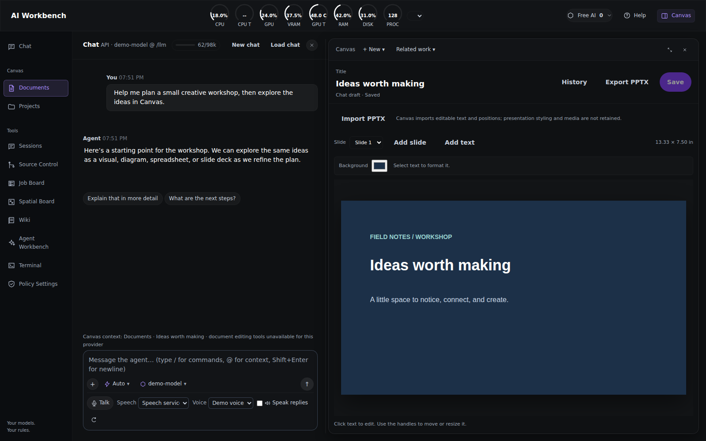](screenshots/canvas-slides.png) | [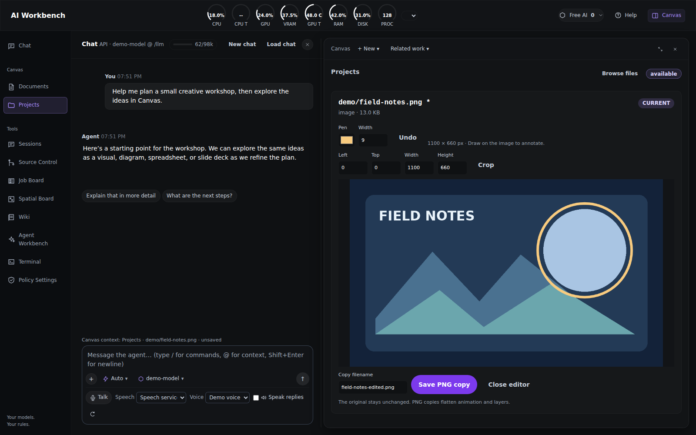](screenshots/canvas-image-editor.png) |

### More Workbench views

| Projects | Jobs Board | Spatial Board |
|---|---|---|
| [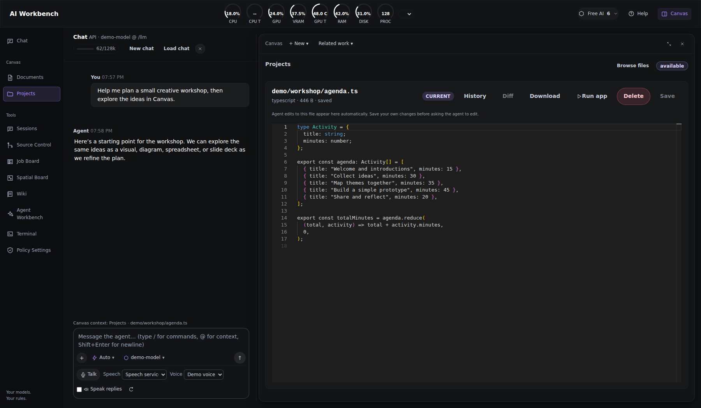](screenshots/projects-workspace.png) | [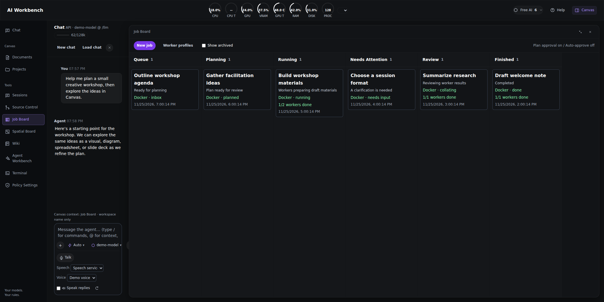](screenshots/jobs-board.png) | [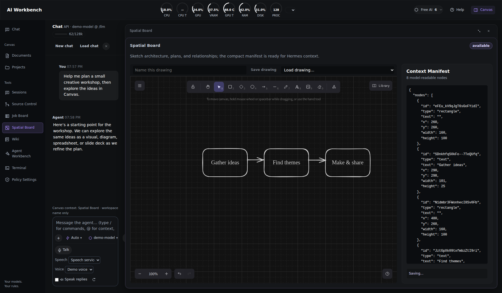](screenshots/spatial-board.png) |
| **Wiki** | **Agent Workbench** | **Chat Sessions** |
| [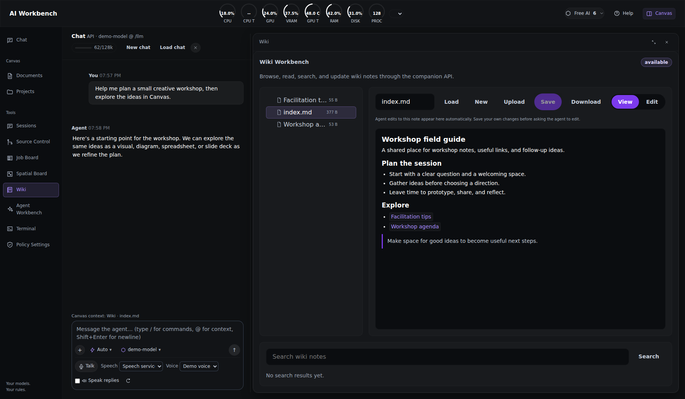](screenshots/wiki-workbench.png) | [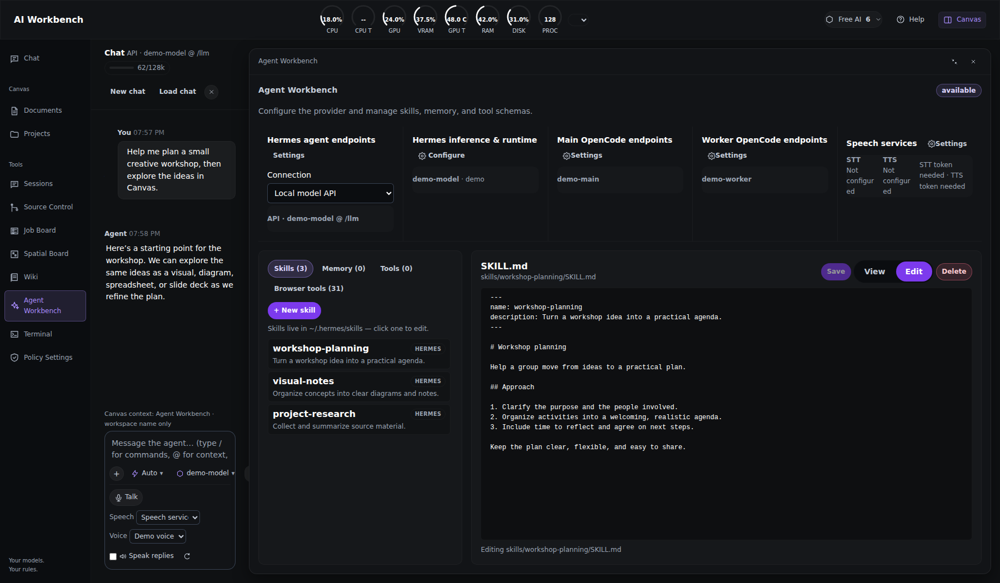](screenshots/agent-workbench.png) | [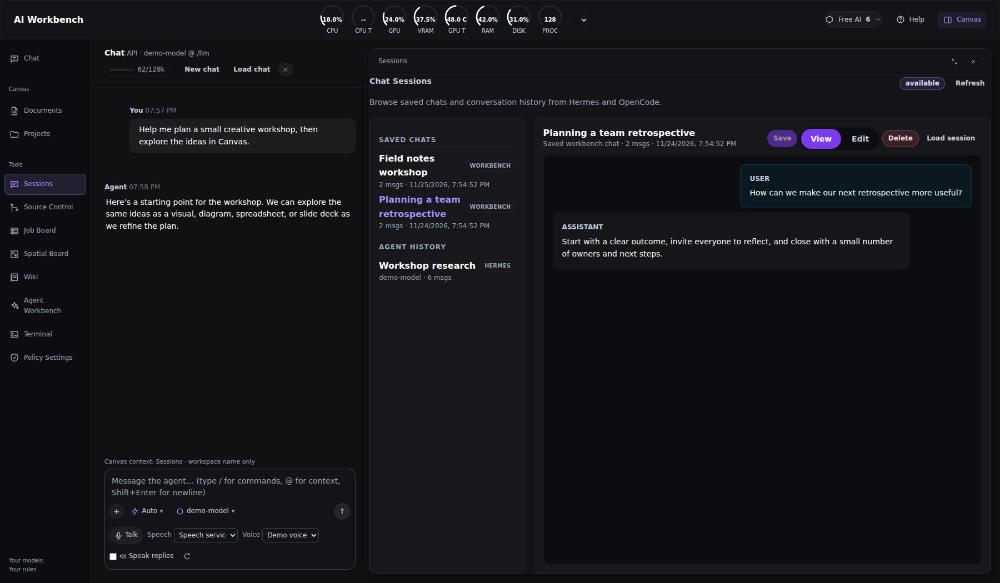](screenshots/chat-sessions.png) |
| **Free AI model tracker** | **Help** | |
| [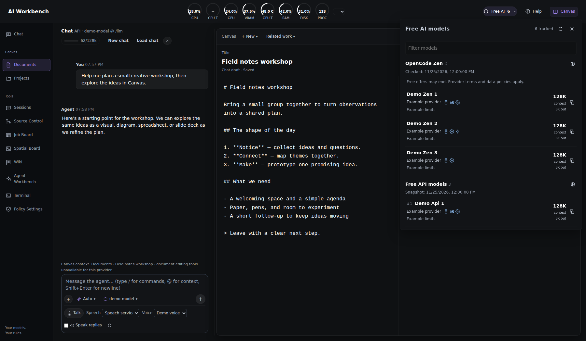](screenshots/free-ai-model-tracker.png) | [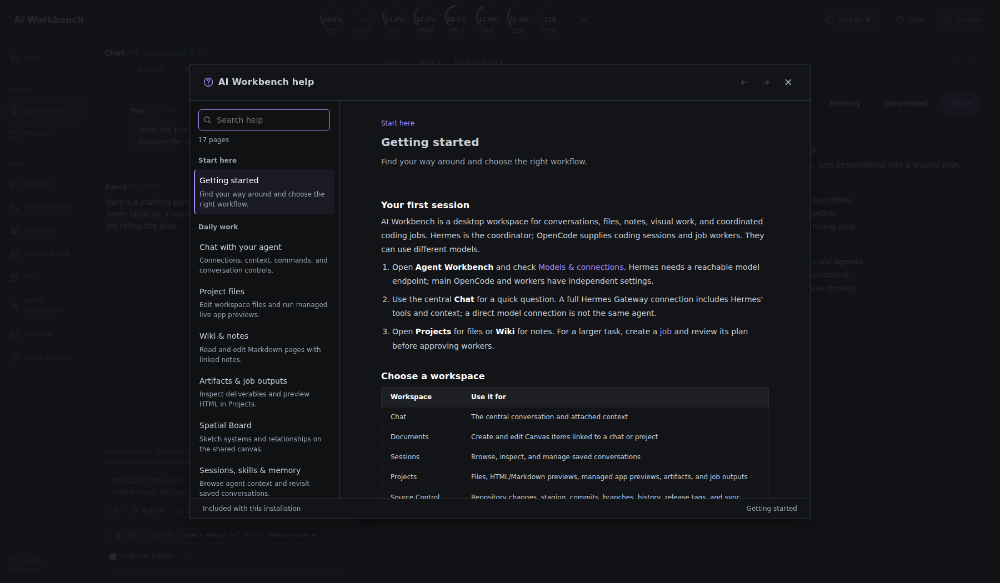](screenshots/help-window.png) | |

## Layout

| Path | What |
|---|---|
| `WORKBENCH_OVERVIEW.md` | Plain-language guide to the Workbench's capabilities and common uses |
| [TODO.md](TODO.md) | Deferred feature ideas and future work |
| `spatial-workbench/` | React 19 + Vite 7 UI (optional Tauri v2 desktop shell in `src-tauri/`) |
| `dashboard_server.py` | Companion API (stats, workspace/wiki files, agent discovery, terminal, shared state) |
| `deploy/` | Container images, compose file, and publish script — see [deploy/README.md](deploy/README.md) |
| `tests/` | Companion API contract tests |
| `API_CONTRACTS.md` | API reference |
| `DESIGN.md` | Visual design tokens and rules |

## Deploy

New to AI Workbench? Start with the [plain-language overview](WORKBENCH_OVERVIEW.md).

See the [deployment guide](deploy/README.md) for the latest-by-default CLI installer and manual Compose setup. The default install binds to loopback for SSH-tunnel access and runs Jobs workers with Herdr; isolated Docker-in-Docker workers are optional. OpenCode Big Pickle is the default worker model unless you choose another model. Hermes still requires an OpenAI-compatible model endpoint for chat, job planning, and collation.

## In-app help

Select **Help** in the header for searchable guides covering first use, chat, files, wiki, artifacts, the Spatial Board, sessions, connections, jobs, worker profiles, free models, terminal access, monitoring, security, updates, and troubleshooting. Related-page links and Back/Forward keep navigation inside the help window. The full deployment guide is included as a reference.

Help ships with the frontend and needs no extra service or internet connection. Focused guides live in `spatial-workbench/src/help/pages/`; the topic catalogue is `spatial-workbench/src/help/helpCatalog.ts`. The deployment reference is bundled directly from `deploy/README.md`, not duplicated. Update help alongside changes to user workflows.

## Free model tracker

The header's **Free AI** pill opens a searchable list with separate OpenCode Zen and free API sections. Rows show input/output capabilities, known tool/reasoning support, context/output limits, and provider rate limits. Click a row to visit its provider page; right-click a row or use its copy button to copy the API model ID.

Middle-click the pill, press `R` within the panel, or use Refresh to refetch. Right-click the pill for the top-ranked API model from the tracker snapshot. Escape or an outside click closes the panel.

The companion server checks the public sources at startup and every 24 hours in the background, even without an open browser. The header also reloads its list every 24 hours while the dashboard is open. The read-only `GET /api/free-models` endpoint caches public metadata for 24 hours; `?refresh=1` forces a refresh. API models come from [ClawLabsAI/free-ai-models](https://github.com/ClawLabsAI/free-ai-models), inspired by [omarchy-freemodels](https://github.com/ArgusGuardian/omarchy-freemodels). Zen uses its [live catalogue](https://opencode.ai/zen/v1/models) intersected with [Models.dev](https://models.dev) entries priced at zero for both input and output, excluding deprecated models. Known expired API offers are excluded. Missing capabilities are unknown, not inferred; catalogue listings are not live availability checks. Source failures retain the last successful list with a stale warning. No API keys or inference requests are used. Free offers can change or end; check provider limits and data policies before use.

## Voice chat

Mobile defaults to **Browser** speech: live dictation updates the composer until Stop or the browser ends the session, with no Workbench recording timer. Browser/system voices handle spoken replies. **Speak replies** remains opt-in, and transcripts are reviewed before explicit Send. Browser support varies; audio or text may be processed by the browser vendor rather than on-device. Unsupported browsers explain the limitation and offer keyboard dictation or an explicit switch to **Speech service**; no automatic server fallback occurs.

Desktop defaults to **Speech service**, with recordings up to three minutes and the existing 8 MB upload limit. This mode transcribes after Stop, not as a stream. Either layout can change the Speech selector. Completed replies can optionally be spoken, replayed, or stopped; mute disables automatic speech. Configure server services in **Agent Workbench → Speech services → Settings**: URL overrides and tokens are saved by the companion server. Blank token fields preserve the saved secret; **Clear** removes it. `SPEECH_STT_URL` and `SPEECH_TTS_URL` remain deployment defaults, and **Use deployment URLs** restores them. Tokens never appear in browser settings or `.env`. This integration expects the supplied wrapper contracts; another provider such as ElevenLabs requires a server-side adapter. The deployed companion container, not merely the repository checkout, must reach the speech host. Microphone use requires HTTPS or localhost. Voice blends are not exposed. Real microphone, mobile browser speech, and configured wrapper interoperability require device validation.

## Jobs board

A job board where Hermes reviews a request, splits it into subtasks, and OpenCode workers execute them using Docker sandboxing or the opt-in persistent Herdr runtime. New jobs snapshot their selected runtime; existing jobs keep Docker execution. Subtasks declare `depends_on` when they need another worker's output, and upstream artifacts are staged for those dependent workers. Docker workers use coordinator clarification/requeue; Herdr workers accept replies in their existing sessions. The board groups internal stages into six lanes and surfaces paused workers under Needs attention. See [deploy/README.md](deploy/README.md#herdr-local-pilot) for the local Herdr pilot and deployment limits.

Jobs also support reusable worker profiles, optional isolated Git worktrees with explicit local review/merge, per-worker retry history, and streamed logs. Token/spend budgets currently require Docker worker usage reporting; Herdr usage remains unavailable. Worker profiles are separate from interactive chat/provider profiles; project workers never push or merge without an explicit board action.

## Live app previews

In **Projects**, choose **Run app**, enter a workspace-relative project folder, start command, and port, then start the preview. The default serves static files with `python3 -m http.server "$PORT" --bind 127.0.0.1` on port `8000`. Commands receive `PORT` and `PREVIEW_BASE`. Readiness and bounded output appear beside the sandboxed preview; **Stop app** terminates its process group. Preview processes are temporary, do not survive an API/container restart, and stop after two hours without preview activity.

Direct API chat can use the Workbench preview tools when its local tool loop is enabled; Hermes Gateway uses the bundled Workbench MCP server. Ask the agent to start the project and follow its **Open live preview** link. Use that Workbench URL, not a remote server's `localhost` URL: app traffic is proxied through the existing Workbench port. In terminal-token mode, use **Set terminal token** in the Projects header; saving the token does not start an app. Gateway MCP credentials are configured server-side, independently of the browser session token.

Preview commands run as the agent user, not in the Jobs worker sandbox, and can access files and network services available to that user. The browser iframe has a separate sandbox boundary, not network isolation. Only run trusted code. HTML root-relative paths are rewritten for common cases; external JavaScript/CSS, generated URLs, cookies, browser storage, and framework routing can need app-specific adjustments. WebSocket/HMR support is not implemented. This is a development preview, not production hosting.

## Component updates

Open **Terminal -> Versions** and use **Check now**. Hermes Agent and OpenCode have visible **Update** buttons, disabled when current or unsupported. Use those buttons for in-place component updates; upstream `hermes update` is a different command and can refuse Docker installations. Workbench and Sandbox updates require re-pulling the appropriate Workbench images and redeploying through your normal administration process. These actions can interrupt active work; back up persistent data first. See the [deployment guide](deploy/README.md#terminal-and-updates) for runtime recovery and image compatibility limits.

## Develop

```bash
cd spatial-workbench
npm install
npm test && npm run build
npm run dev                        # http://localhost:1420

# in another shell
python3 ../dashboard_server.py     # companion API on :8080
python3 -m pytest ../tests
```

All settings come from environment variables (see `deploy/.env.example`). For local development, put overrides in:
- `spatial-workbench/.env.local` — Vite proxy targets: `LLM_API_PROXY_TARGET`, `HERMES_GATEWAY_PROXY_TARGET`, `COMPAT_API_PROXY_TARGET`, `WORKBENCH_ALLOWED_HOSTS`
- `~/.config/spatial-workbench/dashboard.env` (or `WORKBENCH_ENV_FILE`) — API settings: `HERMES_HOME`, `WORKSPACE_ROOT`, `WIKI_ROOT`, `STATS_SOURCE`, `LLAMA_PROPS_URL`, ...

Both are loaded without overriding real environment variables and are never baked into images.
