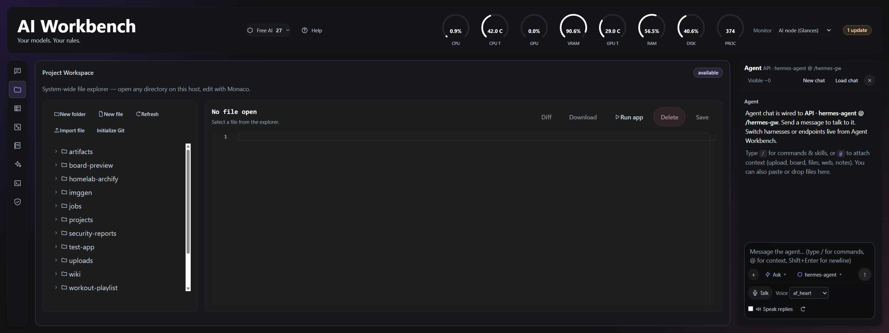

# AI Workbench

*Your models. Your rules.*

A browser-based AI workbench: agent chat (Hermes / OpenCode / any OpenAI-compatible model), project files with Monaco and managed live app previews, a markdown wiki with `[[wikilinks]]`, an Excalidraw spatial board, HTML artifacts, a job board where Hermes plans work and isolated OpenCode workers execute it, and host resource monitoring.

## Screenshots



Full-screen captures of the live workspaces: [Projects](screenshots/projects-workspace.png), [Jobs Board](screenshots/jobs-board.png), [Spatial Board](screenshots/spatial-board.png), [Wiki](screenshots/wiki-workbench.png), [Agent Workbench](screenshots/agent-workbench.png), [Chat Sessions](screenshots/chat-sessions.png), [Free AI model tracker](screenshots/free-ai-model-tracker.png), and [Help](screenshots/help-window.png).

## Layout

| Path | What |
|---|---|
| `WORKBENCH_OVERVIEW.md` | Plain-language guide to the Workbench's capabilities and common uses |
| [TODO.md](TODO.md) | Deferred feature ideas and future work |
| `spatial-workbench/` | React 19 + Vite 7 UI (optional Tauri v2 desktop shell in `src-tauri/`) |
| `dashboard_server.py` | Companion API (stats, workspace/wiki files, agent discovery, terminal, shared state) |
| `deploy/` | Container images, compose file, and publish script — see [deploy/README.md](deploy/README.md) |
| `tests/` | Companion API contract tests |
| `API_CONTRACTS.md` | API reference |
| `DESIGN.md` | Visual design tokens and rules |

## Deploy

New to AI Workbench? Start with the [plain-language overview](WORKBENCH_OVERVIEW.md).

See the [deployment guide](deploy/README.md) for the latest-by-default CLI installer and manual Compose setup. The default install binds to loopback for SSH-tunnel access and runs Jobs workers with Herdr; isolated Docker-in-Docker workers are optional. OpenCode Big Pickle is the default worker model unless you choose another model. Hermes still requires an OpenAI-compatible model endpoint for chat, job planning, and collation.

## In-app help

Select **Help** in the header for searchable guides covering first use, chat, files, wiki, artifacts, the Spatial Board, sessions, connections, jobs, worker profiles, free models, terminal access, monitoring, security, updates, and troubleshooting. Related-page links and Back/Forward keep navigation inside the help window. The full deployment guide is included as a reference.

Help ships with the frontend and needs no extra service or internet connection. Focused guides live in `spatial-workbench/src/help/pages/`; the topic catalogue is `spatial-workbench/src/help/helpCatalog.ts`. The deployment reference is bundled directly from `deploy/README.md`, not duplicated. Update help alongside changes to user workflows.

## Free model tracker

The header's **Free AI** pill opens a searchable list with separate OpenCode Zen and free API sections. Rows show input/output capabilities, known tool/reasoning support, context/output limits, and provider rate limits. Click a row to visit its provider page; right-click a row or use its copy button to copy the API model ID.

Middle-click the pill, press `R` within the panel, or use Refresh to refetch. Right-click the pill for the top-ranked API model from the tracker snapshot. Escape or an outside click closes the panel.

The companion server checks the public sources at startup and every 24 hours in the background, even without an open browser. The header also reloads its list every 24 hours while the dashboard is open. The read-only `GET /api/free-models` endpoint caches public metadata for 24 hours; `?refresh=1` forces a refresh. API models come from [ClawLabsAI/free-ai-models](https://github.com/ClawLabsAI/free-ai-models), inspired by [omarchy-freemodels](https://github.com/ArgusGuardian/omarchy-freemodels). Zen uses its [live catalogue](https://opencode.ai/zen/v1/models) intersected with [Models.dev](https://models.dev) entries priced at zero for both input and output, excluding deprecated models. Known expired API offers are excluded. Missing capabilities are unknown, not inferred; catalogue listings are not live availability checks. Source failures retain the last successful list with a stale warning. No API keys or inference requests are used. Free offers can change or end; check provider limits and data policies before use.

## Voice chat

The composer provides push-to-talk, an editable transcript, and explicit Send through the existing Hermes chat. Completed replies can optionally be spoken, replayed, or stopped; mute disables automatic speech. Configure each installation in **Agent Workbench → Speech services → Settings**: URL overrides and tokens are saved by the companion server. Blank token fields preserve the saved secret; **Clear** removes it. `SPEECH_STT_URL` and `SPEECH_TTS_URL` remain deployment defaults, and **Use deployment URLs** restores them. Tokens never appear in browser settings or `.env`. This integration expects the supplied wrapper contracts; another provider such as ElevenLabs requires a server-side adapter. The deployed companion container, not merely the repository checkout, must reach the speech host. Microphone use requires HTTPS or localhost. Voice blends are not exposed. The wrapper currently reports zero voices and advertises a JSON schema for an endpoint expected to return WAV, so real voice functionality remains unverified until these defects are resolved.

## Jobs board

A job board where Hermes reviews a request, splits it into subtasks, and OpenCode workers execute them using Docker sandboxing or the opt-in persistent Herdr runtime. New jobs snapshot their selected runtime; existing jobs keep Docker execution. Subtasks declare `depends_on` when they need another worker's output, and upstream artifacts are staged for those dependent workers. Docker workers use coordinator clarification/requeue; Herdr workers accept replies in their existing sessions. The board groups internal stages into six lanes and surfaces paused workers under Needs attention. See [deploy/README.md](deploy/README.md#herdr-local-pilot) for the local Herdr pilot and deployment limits.

Jobs also support reusable worker profiles, optional isolated Git worktrees with explicit local review/merge, per-worker retry history, and streamed logs. Token/spend budgets currently require Docker worker usage reporting; Herdr usage remains unavailable. Worker profiles are separate from interactive chat/provider profiles; project workers never push or merge without an explicit board action.

## Live app previews

In **Projects**, choose **Run app**, enter a workspace-relative project folder, start command, and port, then start the preview. The default serves static files with `python3 -m http.server "$PORT" --bind 127.0.0.1` on port `8000`. Commands receive `PORT` and `PREVIEW_BASE`. Readiness and bounded output appear beside the sandboxed preview; **Stop app** terminates its process group. Preview processes are temporary, do not survive an API/container restart, and stop after two hours without preview activity.

Direct API chat can use the Workbench preview tools when its local tool loop is enabled; Hermes Gateway uses the bundled Workbench MCP server. Ask the agent to start the project and follow its **Open live preview** link. Use that Workbench URL, not a remote server's `localhost` URL: app traffic is proxied through the existing Workbench port. In terminal-token mode, use **Set terminal token** in the Projects header; saving the token does not start an app. Gateway MCP credentials are configured server-side, independently of the browser session token.

Preview commands run as the agent user, not in the Jobs worker sandbox, and can access files and network services available to that user. The browser iframe has a separate sandbox boundary, not network isolation. Only run trusted code. HTML root-relative paths are rewritten for common cases; external JavaScript/CSS, generated URLs, cookies, browser storage, and framework routing can need app-specific adjustments. WebSocket/HMR support is not implemented. This is a development preview, not production hosting.

## Component updates

Open **Terminal -> Versions** and use **Check now**. Hermes Agent and OpenCode have visible **Update** buttons, disabled when current or unsupported. Use those buttons for in-place component updates; upstream `hermes update` is a different command and can refuse Docker installations. Workbench and Sandbox updates require re-pulling the appropriate Workbench images and redeploying through your normal administration process. These actions can interrupt active work; back up persistent data first. See the [deployment guide](deploy/README.md#terminal-and-updates) for runtime recovery and image compatibility limits.

## Develop

```bash
cd spatial-workbench
npm install
npm test && npm run build
npm run dev                        # http://localhost:1420

# in another shell
python3 ../dashboard_server.py     # companion API on :8080
python3 -m pytest ../tests
```

All settings come from environment variables (see `deploy/.env.example`). For local development, put overrides in:
- `spatial-workbench/.env.local` — Vite proxy targets: `LLM_API_PROXY_TARGET`, `HERMES_GATEWAY_PROXY_TARGET`, `COMPAT_API_PROXY_TARGET`, `WORKBENCH_ALLOWED_HOSTS`
- `~/.config/spatial-workbench/dashboard.env` (or `WORKBENCH_ENV_FILE`) — API settings: `HERMES_HOME`, `WORKSPACE_ROOT`, `WIKI_ROOT`, `STATS_SOURCE`, `LLAMA_PROPS_URL`, ...

Both are loaded without overriding real environment variables and are never baked into images.
